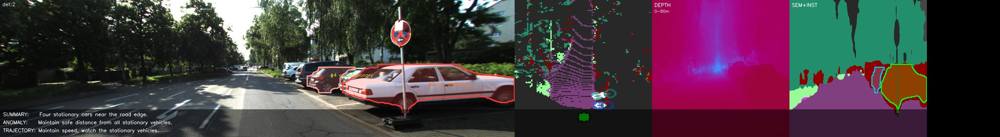
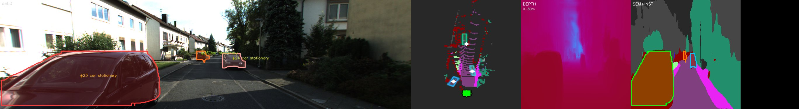
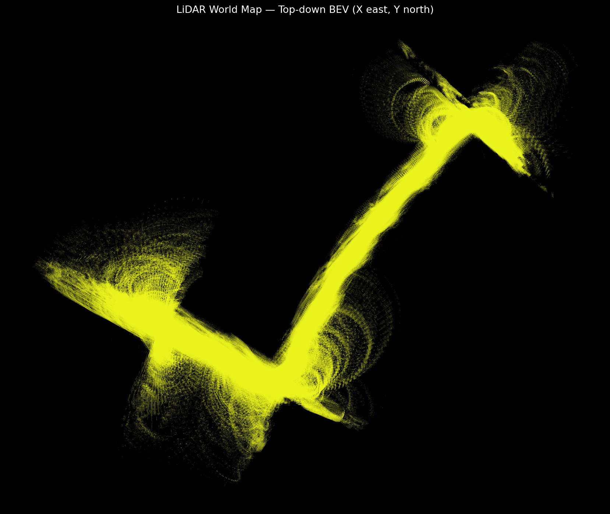

# Fusion Perception Pipeline

A multi-sensor autonomous driving perception pipeline that fuses monocular camera and LiDAR inputs using open-vocabulary 3D detection, Kalman + visual multi-object tracking, BEV occupancy mapping, monocular depth estimation, semantic road segmentation, and Gemma 4 language-based scene reasoning.

---

## Results - KITTI-360 Drive 
### Annotated composite (frame 100) — with Gemma scene caption

Each frame is a 4-panel composite: **camera view** (3D boxes + track IDs) · **BEV occupancy grid** · **depth map** · **semantic segmentation**.



> *Summary: "Four stationary cars near the road edge."
> Caution: Maintain a safe distance from the stationary vehicles."
> *Summary: "Maintain speed, watch the stationary vehicles."- Gemma 4 2B-IT*

---

### Raw composite (frame 300) - detection + tracking + BEV



---

### LiDAR world map - top-down BEV accumulated over full drive



> Accumulated LiDAR point cloud projected to the world frame via KITTI-360 pose transforms, rendered as a bird's-eye-view map.

---

## Architecture

```
Video / KITTI-360 sequence
         │
         ▼
 WildDet3D  ──────────────────────────────── open-vocabulary 3D detection
         │  Detection3D list per frame
         ├──► YOLO26 (2D fusion, optional)
         │
         ▼
 KalmanCoWTracker ────────────────────────── multi-object tracking
         │  ByteTrack two-stage association
         │  Kalman filter + CoWTracker pixel refinement
         │  Pose-based ego-motion compensation
         │
         ▼
 BEV Occupancy Grid ─────────────────────── LiDAR fusion + track centroids
         │  Exponential decay · LiDAR rasterisation (0.6) · tracks (1.0)
         │
         ├──► RoadSegmentor (YOLO26n-sem, Cityscapes semantic BEV)
         │
         ├──► MonoDepthEstimator (DA-V2 + LiDAR anchor)
         │
         ▼
 Gemma 4 2B-IT ──────────────────────────── language scene reasoning
         │  Natural-language summary + anomaly + recommended action
         │
         ▼
 Outputs: annotated video · detections.json · tracks.json · reasoning.json
          lidar_map.ply · map_topdown.png · eval_metrics.json
```

---

## Pipeline components

| Component | File | Description |
|-----------|------|-------------|
| 3D Detector | `fusion_perception/models/wilddet3d_wrapper.py` | [WildDet3D](https://github.com/allenai/WildDet3D) — open-vocabulary monocular 3D detection via text prompts |
| 2D Detector | `fusion_perception/models/yolo26_detector.py` | YOLO26 2D detector fused with WildDet3D boxes via IoU |
| Tracker | `fusion_perception/tracking/kalman_cowtracker.py` | Kalman filter + [CoWTracker](https://github.com/facebookresearch/co-tracker) visual tracking; ByteTrack two-stage association |
| Ego-motion | `fusion_perception/tracking/ego_motion.py` | Pose-based 3D ego-motion compensation from KITTI-360 `poses.txt` (missing pose frames interpolated) |
| Motion gate | `fusion_perception/tracking/motion_gate.py` | Static / moving decision from ego-compensated positions; holds velocity at zero until motion is shown |
| LiDAR semantics | `fusion_perception/models/utonia_wrapper.py`, `fusion_perception/segmentation/lidar_probe.py` | [Utonia](https://github.com/Pointcept/Utonia) point-cloud encoder + linear probe trained on KITTI-360 labels (optional) |
| BEV Grid | `fusion_perception/occupancy/bev_grid.py` | Bird's-eye-view occupancy: exponential decay → LiDAR rasterisation → track centroids |
| Road Segmentor | `fusion_perception/segmentation/road_segmentor.py` | YOLO26n-sem Cityscapes semantic labels projected onto BEV |
| Depth | `fusion_perception/depth/` | Depth-Anything-V2 monocular depth with LiDAR frustum anchoring and quality gate |
| Reasoner | `fusion_perception/models/gemma_wrapper.py` | Gemma 4 2B-IT with 4-bit quantisation; rolling scene-memory context |
| Prompt Builder | `fusion_perception/reasoning/prompt_builder.py` | Converts `SceneMemory` snapshots to structured scene descriptions |
| Data Loader | `fusion_perception/data/` | KITTI-360 frames, raw KITTI LiDAR, calibration, GT labels |
| Evaluation | `fusion_perception/evaluation/` | mAP · MOTA / MOTP · occupancy IoU; cross-dataset benchmark |

---

## Quickstart

### 1 — Install

```bash
pip install torch==2.5.1+cu121 torchvision==0.20.1+cu121 \
    --index-url https://download.pytorch.org/whl/cu121
pip install git+https://github.com/allenai/WildDet3D
pip install git+https://github.com/facebookresearch/co-tracker
pip install -e .
```

### 2 — Download WildDet3D checkpoint

```bash
mkdir -p ckpt
huggingface-cli download allenai/WildDet3D \
    wilddet3d_alldata_all_prompt_v1.0.pt --local-dir ckpt/
```

### 3 — Run on a video

```bash
python inference.py --video path/to/clip.mp4 --save-debug-frames
```

### 4 — Run on KITTI-360 (with LiDAR + evaluation)

```bash
python inference.py \
    --kitti360-root /data/KITTI-360 \
    --kitti360-seq  2013_05_28_drive_0000_sync \
    --max-frames 500 \
    --save-debug-frames --debug-every 50 \
    --eval
```

Outputs are written to `outputs/`:

```
outputs/
├── output.mp4            # annotated composite video
├── detections.json       # per-frame 3D detections
├── tracks.json           # track history with 3D centroid trajectories
├── reasoning.json        # Gemma reasoning outputs (prompt + summary)
├── eval_metrics.json     # mAP / MOTA / MOTP vs. KITTI-360 GT
├── lidar_map.ply         # accumulated world-frame point cloud
├── map_topdown.png       # top-down BEV render of lidar_map.ply
├── map_side.png          # side-view BEV render
├── stats.png             # per-frame detection / track count chart
└── debug_frames/
    ├── frame_000000.jpg      # raw composite (no caption overlay)
    ├── captioned_000000.jpg  # composite + Gemma caption overlay
    └── ...
```

---

## Google Colab

Open `notebooks/pipeline_finetune.ipynb` in Colab with a **T4 GPU** runtime.

Runs the full pipeline end-to-end on a KITTI sequence, then fine-tunes Gemma 4 2B on the collected reasoning outputs.

**Notebook sections:**
1. Mount Drive, install all dependencies
2. Download KITTI data, parse real camera intrinsics
3. Run pipeline (prints each reasoning output live)
4. Inspect training data — statistics, length histogram, example pairs
5. QLoRA fine-tuning with loss curve visualisation
6. Evaluate fine-tuned adapter vs. base model

---

## Configuration

All config lives in `configs/`. Configs are merged left-to-right at runtime:

```bash
python inference.py --config configs/default.yaml configs/colab.yaml --video clip.mp4
```

Key settings in `configs/default.yaml`:

```yaml
detection:
  prompts: ["car", "person", "cyclist"]   # open-vocabulary text prompts
  score_threshold: 0.4

tracking:
  backend: "kalman_cow"   # "kalman_cow" | "cowtracker"
  ego_motion: true        # pose-based 3D ego-motion compensation

depth:
  enabled: true
  model_size: "small"     # "small" | "base" | "large"
  lidar_anchor:
    enabled: true         # refine per-detection depth from LiDAR frustums

occupancy:
  resolution: 0.5         # metres per cell
  x_range: [-25.0, 25.0] # lateral range (metres)
  z_range: [-10.0, 60.0] # forward range (metres)

reasoning:
  enabled: true
  interval_frames: 30     # run Gemma every 30 frames
  quantize_4bit: true
```

---

## Fine-tuning Gemma 4 2B

Every `reasoning.json` entry contains `prompt_used` + `summary`, which become training pairs automatically:

```python
# Each entry becomes:
{
  "messages": [
    {"role": "user",      "content": "<scene prompt>"},
    {"role": "assistant", "content": "<gemma summary>"}
  ]
}
```

Fine-tuning uses HuggingFace `peft` + `trl` (QLoRA):

```python
from peft import PeftModel
from transformers import AutoModelForCausalLM

base  = AutoModelForCausalLM.from_pretrained("google/gemma-4-2b-it", ...)
model = PeftModel.from_pretrained(base, "ckpt/gemma4_lora")
```

See `notebooks/pipeline_finetune.ipynb` (Section 5) for the full training setup.

---

## Benchmarking

```python
from omegaconf import OmegaConf
from fusion_perception.evaluation import BenchmarkRunner

cfg = OmegaConf.merge(
    OmegaConf.load("configs/default.yaml"),
    OmegaConf.load("configs/benchmark.yaml"),
)
runner = BenchmarkRunner(cfg, datasets=["kitti-360", "waymo"], logs_per_dataset=3)
report = runner.run()
# Writes outputs/benchmark/<date>/report.md + report.json
```

Metrics reported per dataset and per log:

| Metric | Description |
|--------|-------------|
| **mAP** | Mean average precision at IoU 0.5 (BEV axis-aligned boxes) |
| **MOTA** | Multi-object tracking accuracy (CLEAR MOT) |
| **MOTP** | Multi-object tracking precision (mean BEV centre distance) |
| **Occ IoU** | Binary occupancy grid IoU vs. ground-truth LiDAR |

Requires `PY123D_DATA_ROOT` pointing to your datasets directory.

---

## Project structure

```
fusion_perception/
├── data/           # KITTI-360 / KITTI raw loaders, calibration, GT labels
├── depth/          # DA-V2 monocular depth, LiDAR anchor, quality gate
├── evaluation/     # metrics (mAP, MOTA, MOTP), benchmark runner
├── memory/         # Gemma rolling scene-memory buffer
├── models/         # WildDet3D, YOLO26, Gemma, frustum detector wrappers
├── occupancy/      # BEV grid with LiDAR fusion and exponential decay
├── planning/       # ego state from poses, BEV check for planned paths
├── pipelines/      # StageRunner (per-frame orchestration)
├── reasoning/      # prompt builder, Jinja2 templates
├── segmentation/   # YOLO26n-sem road segmentor
├── tracking/       # KalmanCoWTracker, ByteTrack association, ego-motion
├── utils/          # dataclasses, geometry, logging, video loader
└── visualization/  # BEV renderer, frame annotator, output compositor

configs/            # YAML configs (default, colab, benchmark, ...)
docs/               # assets (README images), plans, session notes
notebooks/          # Colab notebooks
scripts/            # one-off development / notebook-fix scripts
tests/              # pytest unit tests (~20 test files)
inference.py        # two-pass inference CLI (detection → Gemma)
run.py              # lightweight single-pass CLI entry-point
```

---

## Requirements

- Python 3.10+
- CUDA GPU with ≥10 GB VRAM (T4 or better for Colab)
- See `requirements.txt` for Python packages

---

## Known Issues & To Do

- **Try larger YOLO26 variants for better detection recall.**
  The current config uses `yolo26n` (nano) as the 2D detector. Upgrading to `yolo26s` or `yolo26m` should improve recall on small or partially-occluded vehicles at the cost of extra VRAM and inference time. Worth benchmarking against the existing mAP numbers on the KITTI-360 drive.

- **Ego-motion false motion on suddenly appearing parked cars — fix in place, needs a KITTI-360 run to confirm.**
  Two changes:
  - `PoseEgoCompensation` now interpolates frames missing from `poses.txt` (KITTI-360 leaves out frames, e.g. while the car is stopped). Before, each gap dropped compensation for that frame *and* the next one, so static objects jumped by the ego displacement.
  - A motion gate in the tracker keeps each track's measured positions, warps them with the same ego transform as the Kalman state, and fits their ground-plane speed. Velocity stays at zero while the track is `unknown` or `static`, so a noisy first box no longer becomes a velocity. Positions come from the object's own LiDAR points (`utils/lidar_object.py`, ≥5 frames) or from box centres when there is no LiDAR (≥10 frames). Tune with `tracking.motion_gate_*` in `configs/default.yaml`.

- **In progress: add the Qwen-Drive planner, checked against the BEV grid.** Ego state and BEV check are built (see *Planning support* below); the Qwen-Drive wrapper is next.
  [Qwen-Drive-1.0](https://github.com/QwenLM/Qwen-Drive-1.0) (Apache-2.0) predicts a 5 s ego path (50 points of x, y, heading) from three cameras and ego state. The pipeline has no planner today, so this would be a new stage after the BEV grid. Following the BEV-Forcing result below (see *Related work*), the BEV grid is the shared interface between perception and the planner, not the camera images:
  - **Camera mismatch.** Qwen-Drive was trained on front, front-left and front-right cameras; KITTI-360 has a forward stereo pair and two side fisheyes. Expect a quality drop. Feed the front camera (plus undistorted side views if tried) and treat the plan as a proposal.
  - **Ego state** (speed, acceleration, turn command) comes from `poses.txt` via `PoseEgoCompensation`. The turn command is derived from the future heading change.
  - **BEV check.** Rasterise the planned path into the BEV grid and flag plans that cross occupied cells, non-road cells (camera or Utonia LiDAR semantics), or the predicted paths of moving tracks. Only the motion gate's `moving` tracks are extrapolated, so parked cars are obstacles, not traffic.
  - **Evaluation.** Open-loop error against the real future ego path from `poses.txt` (average and final displacement at 1/2/3 s), plus the rate of BEV-check violations.
  - **Hardware.** About 11 GB of weights in bf16 and a 24 GB GPU recommended; a T4 likely needs 4-bit loading and no FlashAttention. Run it every N frames, like Gemma.

## Planning support (no planner model yet)

`fusion_perception/planning/` holds what a planner needs from this pipeline, built and tested before the planner itself:

| File | What it does |
|------|--------------|
| `ego_state.py` | From KITTI-360 poses: speed and acceleration, 1.5 s past path, 5 s future path actually driven, and a left / straight / right turn command from the heading change over the next 30 m. `EgoState.to_qwen_drive()` gives the ego fields in Qwen-Drive's layout (x forward, y left, heading positive left). |
| `bev_check.py` | Checks a planned path on the BEV grid: **obstacle** (LiDAR returns above the ground, plus boxes of tracks not moving), **off_road** (camera or Utonia LiDAR semantics), **agent** (too close to a moving track's constant-velocity forecast). The ego car is three discs along its heading. |
| `metrics.py` | ADE / FDE at 1, 2, 3 s against the driven path. |
| `audit.py` | Runs the BEV check on the path the car actually drove. That path is safe, so every flag is a false alarm. |

The existing occupancy grid marks every LiDAR return, road surface included, so the check builds its own obstacle layer with the ground removed (by Utonia labels, or by height above the lowest return within 2 m).

Run it on a drive with `planning.enabled: true` in the config. At the end it prints how often the driven path was flagged, per check type, and writes `planning.json` (per-frame ego state, command and check result). A low false-alarm rate is what makes the check worth trusting on Qwen-Drive's paths; if one type is high, tune `planning.bev_check` first.

## Utonia LiDAR semantics (optional)

[Utonia](https://github.com/Pointcept/Utonia) is a pretrained point-cloud encoder (PTv3). It returns one feature vector per LiDAR point, and a linear layer trained on KITTI-360's 3D semantic labels turns those into 13 classes (`segmentation/lidar_classes.py`). In the pipeline the classes pick each detection's own LiDAR points (car points, not road or walls behind it), which makes the motion gate's position input steadier.

```bash
pip install spconv-cu121
pip install torch-scatter -f https://data.pyg.org/whl/torch-2.5.1+cu121.html
pip install git+https://github.com/Pointcept/Utonia
pip install scipy

python scripts/train_utonia_probe.py \
    --kitti360-root /data/KITTI-360 --seq 2013_05_28_drive_0000_sync \
    --variant utonia_small --stride 10 --out ckpt/utonia_probe.pt
```

Needs `data_3d_semantics/train/<seq>/` and `data_3d_raw/<seq>/` from KITTI-360. KITTI-360 doesn't label single scans, so labels are copied from its accumulated semantic clouds by nearest neighbour. The script reports validation mIoU and a **scan-to-map distance** per sequence: how far each scan lands from KITTI-360's map after the LiDAR→IMU→world transform. That number checks your calibration and poses: a wrong extrinsic shows up as a large median distance. Then set `lidar_semantics.enabled: true`.

Notes: Utonia's weights are CC-BY-NC 4.0 (non-commercial). On a T4 keep `enable_flash: false`. `--scale` sets the voxel size (0.01/scale m) and may need tuning for outdoor LiDAR.

## Related work

- **BEV as the interface between perception and driving.** Azevedo, Sabatini, Hornauer and Moutarde, *Towards Zero-Shot Transfer Across Embodiments For Driving VLAs* ([arXiv:2609.02341](https://arxiv.org/abs/2609.02341)). Driving vision-language-action models are usually trained on one dataset and camera rig and transfer poorly to new ones. The paper adds *BEV-Forcing*, an auxiliary bird's-eye-view objective, arguing that BEV is a more consistent, rig-independent representation for driving than image-plane depth. It improves zero-shot transfer to unseen datasets and camera rigs, though the gain shrinks as more training datasets are mixed (WOD-E2E, NAVSIM, nuScenes). This pipeline makes the same choice by fusing camera, LiDAR and tracks into one BEV grid before reasoning, and the planned Qwen-Drive stage uses that grid to check plans made from KITTI-360's non-standard camera rig.
- **Utonia** — one pretrained encoder for many kinds of point clouds ([arXiv:2603.03283](https://arxiv.org/abs/2603.03283), [code](https://github.com/Pointcept/Utonia)); used for LiDAR semantics.
- **Qwen-Drive-1.0** — vision-language driving model with a planning expert ([code](https://github.com/QwenLM/Qwen-Drive-1.0)); candidate planner.

---

## License

MIT
